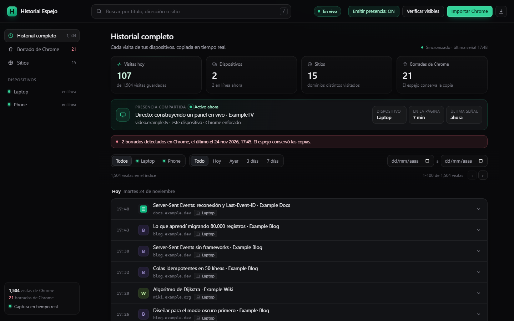
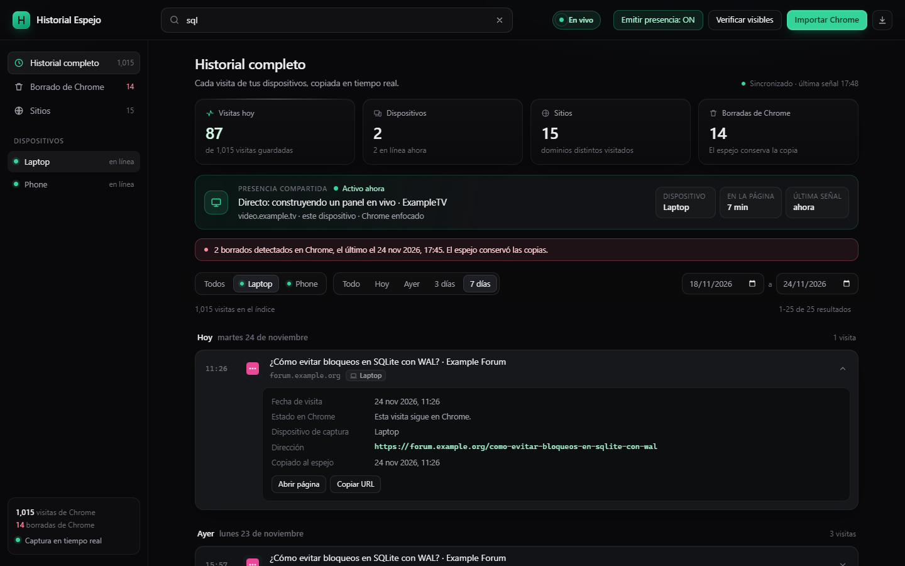
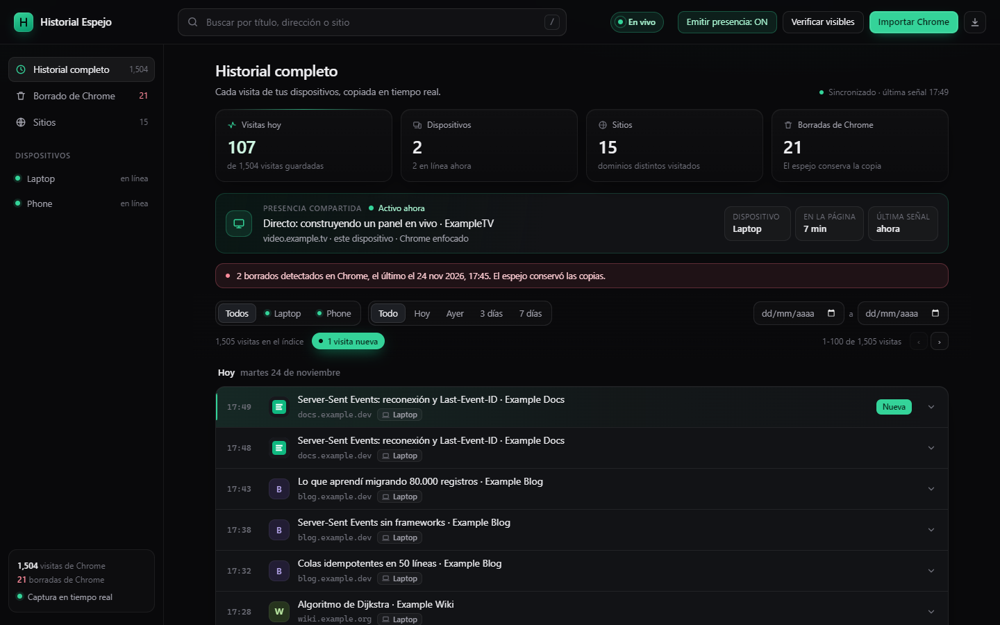
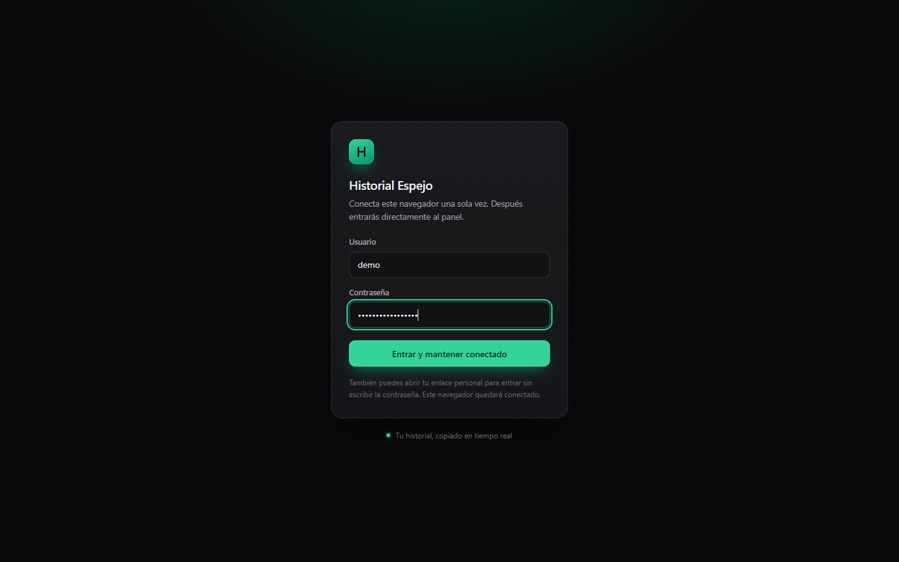
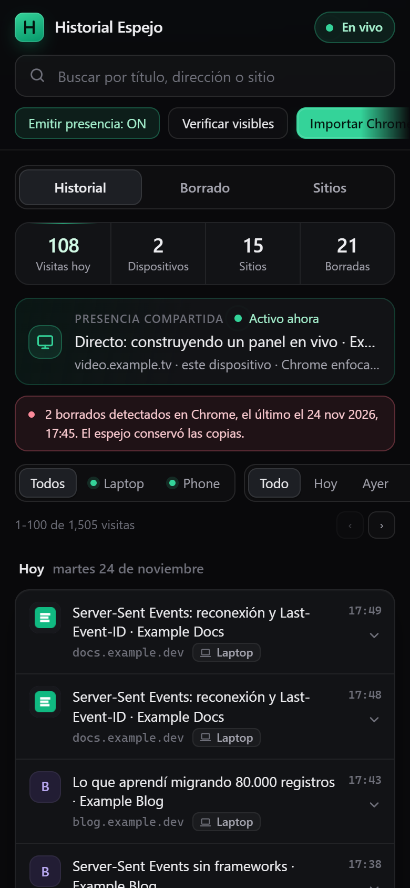

# Browsing History Mirror

A self-hosted, real-time backup of **your own** Chrome browsing history. A Manifest V3 extension captures visits and tabs, and syncs them to a small Python server on a VPS. A web panel, protected by login, then shows the timeline from any device, including while the laptop is off.

   

> Personal project, built for my own devices. Capturing from any other device is opt-in: the extension asks the user to name the device and explicitly accept before it shares anything.

## Architecture

```text
Chrome extension (MV3)                         VPS
┌─────────────────────────┐   HTTPS batches   ┌──────────────────────────────────────────┐
│ history / tabs / devices│ ───────────────►  │ /api/collector/sync  (token per device)  │
│ IndexedDB v5 (offline)  │   ack + retry     │   └► mirror.sqlite3   (original records) │
│ retry queue, dedup keys │ ◄───────────────  │        └► projection queue              │
└─────────────────────────┘                   │             └► timeline.sqlite3 (WAL)    │
                                              │ /api/timeline · /api/live (SSE) · auth   │
                                              └──────────────────────────────────────────┘
                                                 ▲ web panel (desktop + mobile CSS)
```

- **Lossless sync:** records are written to IndexedDB first, then sent in batches, and only marked as synced once the server acknowledges them. Retries use backoff. Stable hashed keys prevent duplicates.
- **Two-stage storage:** the original records are kept immutable in one SQLite database. A worker projects them into a timeline database optimized for paging, using rowid pagination instead of re-sorting.
- **Live panel:** Server-Sent Events push new visits to the panel. Sessions are persistent, signed and revocable. The panel has search, filters and pages of 100 records.
- **Operations:** hardened systemd units (`ProtectSystem=strict`, `NoNewPrivileges`, `PrivateTmp`) with `Type=notify` and a 90-second watchdog. Worker processes run separately for archiving and checkpoints.

## Screenshots

All screenshots use synthetic data from `webapp/demo_seed.py`: fictional sites under `*.example.*`, invented page titles, two demo devices. No real browsing history.

| Timeline grouped by day | Search and filters |
|---|---|
|  |  |
| **Live update over SSE** | **Login** |
|  |  |

<p align="center"></p>

## Results (measured in production)

| Metric | Result |
|---|---|
| Records synced | **94,702 with 0 lost** |
| Original keys preserved across a migration | **82,281 / 82,281** |
| Visits captured while the laptop was offline | **11,778** |
| Timeline page latency (100 rows) | **~0.15 s** |
| Burst test | **77 requests in 90 s, all < 0.59 s** |
| Sustained load test | 300 s with no errors |
| Footprint | ~5 GB of data on a **2 GB RAM** VPS |

## Repository layout

```text
extension/   Chrome MV3 extension: background worker, IndexedDB store, sync client, popup and viewer
webapp/      Python server (stdlib http.server): auth, collector API, timeline, SSE, workers
infra/       systemd units and the session start script
```

About 3,100 lines of JavaScript and Python. The server uses only the Python standard library: no frameworks, no ORM.

## Setup

1. Server: copy `webapp/` to the VPS and set `MIRROR_DOMAIN` to your domain (`HISTORIAL_DATA` sets the data directory). Install the units from `infra/` and put Caddy or Nginx in front for TLS. Optionally set `MIRROR_COLLECTOR_ORIGINS` to the extension origin(s) allowed to call the collector API from a page.
2. Extension: copy `extension/web_sync_config.example.js` to `web_sync_config.js`, set your endpoint and device token, and load `extension/` unpacked in Chrome. For the always-on session in `infra/`, set `EXTENSION_ID` (and optionally `BROWSER_BIN`).

Secrets (`web_sync_config.js`, access and token files, databases) are git-ignored and never committed.

## Demo with synthetic data

Try the panel locally without any real history:

```bash
export HISTORIAL_DATA=$PWD/.demo-data
python webapp/demo_seed.py && MIRROR_DOMAIN=localhost python webapp/server.py
```

Then open <http://localhost:6082/> and sign in with the username and password that `demo_seed.py` prints (they are generated per run and only exist in the throwaway directory).

`demo_seed.py` creates the throwaway data directory (it refuses to touch a non-empty directory it did not create), writes demo `tokens.json` and `access.json`, and sends about 1,500 fictional visits from two devices ("Laptop" and "Phone") through the real collector route, `POST /api/collector/sync`. Storage, projection, the timeline index and the search index all run through the app's own code. A few visits are marked as deleted from Chrome. Delete `.demo-data/` when you are done.

---
Author: **Jovany Morales del Ángel** · MIT License
